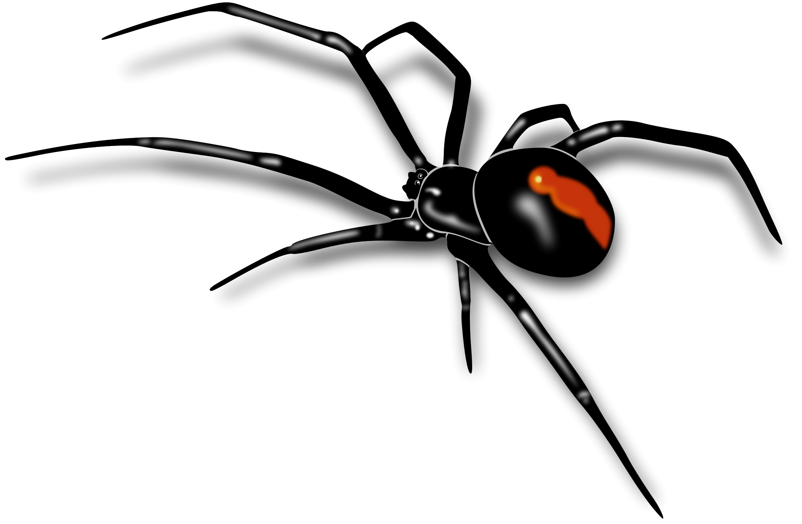
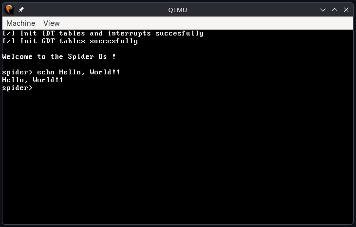

<p align="center">
  
</p>

# Spider
Spider is a custom operating system writen from scratch in
C and Assembly, for my personal usage.

# How to run this project

### For your own usage
At this point i highly discourage anyone to try to use this OS
as his daily driver due to the lack of features and stability reasons.

THIS PROJECT IS STILL IN DEVELLOPMENT !!!!

### For development

This operating system support multitude architecture specified inside
the `/arch` folder.

Clone the repo via the command:
```
git clone --recursive https://github.com/NasriAnis/Spider.git
```

To run this OS you need the qemu emulator and some ISO/boot tools.
The list of requirements is: `qemu`, `xorriso` (from `libisoburn`), `limine`.

After choosing your tarrget OS, you just have to run these commands
at the root directory of the project:

```
make ARCH=<TARGET_ARCH_FOLDER>        # build to project
make ARCH=<TARGET_ARCH_FOLDER> iso    # build the iso
make ARCH=<TARGET_ARCH_FOLDER> run    # run the iso inside qemu
make ARCH=<TARGET_ARCH_FOLDER> debug  # run the iso in debug mode
make ARCH=<TARGET_ARCH_FOLDER> clean  # clean build file in the project
```

For more info on how to contribute head to [CONTRIBUTING.md](CONTRIBUTING.md).

# Docs
Various documentations can be found in the `docs/` folder,
this include some architecture logic, tools used, ambitions
for this project etc...

# Note
Since this project is still in active dev, some documentations
and other stuffs can be missing.

# images
<p align="center">
  
</p>